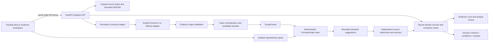

# Architecture

The retained API schema supports legacy claims and adds typed rich scope, criteria, monetary qualifiers, refund/timing fields and separate model suggestions. `promisegraph/extensions.py` bridges that schema to independently testable modules in `promisegraph/advanced/`. Existing legacy routes, baseline authored example and Ollama identity remain supported.

Source dates/stages are user metadata, distinct from a claim's process scope. Unknown dates give Document Sequence grouped by stages; dated shared versions yield changed terms. Candidate retrieval remains conservative exact normalized category/subject/predicate buckets; semantically different names can be missed. Semantic suggestions never overwrite deterministic classifications.

Original bytes persist under UUID filenames. Extraction cache keys include source ID, recorded SHA256, actual model, prompt version and date/stage/version metadata. Bytes are checked against their recorded hash before inference/cache reuse. Successful sources survive partial failures. Jobs interrupted on restart become retryable failed cases. SQLite cache migration is idempotent and additive. Only one API worker is supported.

Review history records analysis, findings, metadata and claim corrections. Recalculation retains reviews only for unchanged finding semantics. PromiseLab never saves edited hypothetical fields. Personal Reality inputs are transient. Draft generation records provider identity; no send operation exists.

React Flow keeps the existing graph and adds filters, connected-node highlighting and a detail panel. Every edge derives from stored source/claim/finding records. Text/PDF anchors are independently located; PDF pages render into bounded PNG previews. Image text is explicitly approximate. Graphs show provenance, never hidden reasoning.

Both servers bind loopback. No cross-origin allowance is enabled; browser origins and Host headers are restricted to supported localhost surfaces. UUID file routes are protected by this local boundary, not by user authentication. Internet deployment requires authentication and a different hosting design.
