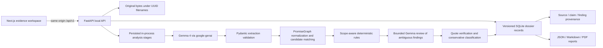

# Architecture

The API stores source bytes outside the database and persists complete typed analysis records in a single versioned document table. This deliberately avoids a premature distributed system. The database migration is idempotent. A multi-tenant version should migrate normalized records through Alembic, add authorization and authenticated file storage, and move jobs to a worker queue.

React Flow shows the supplied evidence chain. It supports pan/zoom, draggable nodes, selection, and accessible evidence-list equivalents. Findings filters are in the Findings view; graph filtering is deferred. Selecting a source or claim opens its source record; selecting a finding opens the comparison dialog.

Native Windows development is supported. The frontend proxies to Python on loopback. There is no browser-side API credential and no external connector dependency.
